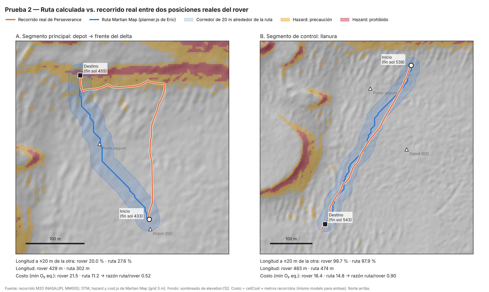

# MarsWalk — EVA traverse planner for Jezero Crater (NASA Space Apps 2026)

**Challenge:** Interplanetary Survival Guide: Martian Map · **Team:** CheeriOS

MarsWalk plans walking EVAs (extravehicular activities) on real Mars terrain, with **oxygen as the cost** and **"can I still
get home?" as a hard rule at every step**. The **habitat console** plans the route; the **field tablet** guides the
astronaut. When something changes (solar particle event, dust storm, suit failure, an obstacle the astronaut reports, a task
that runs long, the Sun going down), the route is **re-planned in milliseconds** and pushed to the tablet.

Built on real NASA data: HiRISE DTM of Jezero (1 m → 3 m grid), Perseverance's traverse and Three Forks sample depot,
NASA spacesuit studies (ICES-2026-127 / -158), MSL/RAD radiation, Mars Climate Database.

## Try it online
**https://cheeriosspaceapp.github.io/marswalk/** → press **▶ Launch demo** and pick a scenario. It opens the field tablet
in a new window (allow pop-ups) and the habitat console in the same tab. The tablet walks by itself (×60) and the
scenario injects its alert. Keep both windows visible side by side: a hidden window is paused by the browser.

| Scenario | What happens |
|---|---|
| EVA-1 nominal 09:00 | Habitat → 10 depot tubes → Wildcat Ridge → habitat. GO, back 12:04 LMST, 42 % of O₂ |
| SPE at Wildcat | Solar particle event on arrival at Wildcat → SEV rover radiation shelter (Hawksbill is not protected) |
| O2 leak → cache rescue | Tank at 50 %, leak after a survey task: habitat ✗ not enough O₂ → Cache 1 ✓ refill 120 O₂-min, then home |
| Late start 15:00 | Back after sunset (17:37 LMST) → NO-GO; the tablet does not walk out |

Direct links: `console.html?demo=<id>` (ids in `web/public/data/jezero/presets.json`), `tablet.html?demo=1`.

## Run it locally
```bash
cd web
npm install
npm run dev
```
- Habitat console: http://localhost:5173/console.html
- Field tablet: http://localhost:5173/tablet.html (open both side by side)
- Planner test bench: http://localhost:5173/planner-test.html?site=jezero

Add `?site=mock` to any page for the synthetic test terrain.

## Results — EVA-1 on real Jezero terrain
Habitat → 10 sample-depot tubes → Wildcat Ridge → habitat: **1432 m, 190 min (165 of them working), 42 % of O₂,
192 min of O₂ margin, 0.075 mSv. Safe, GO from a 09:00 LMST start.**
Re-plan after an alert: 11–65 ms. Full numbers and method: [docs/PLANNER.md](docs/PLANNER.md).

## How it works (one paragraph per piece)
- **Planner (Eric).** Global costmap + global planner, as in ROS 2 Nav2. Optimal A\* on a 1000 × 1000 oxygen-cost grid; a
  Dijkstra "cost-to-home" field gives an O(1) point-of-no-return check anywhere; safety rules: O₂ return with an 18 % reserve,
  1770 m walkback, battery, daylight. Details, complexity and verification: [docs/PLANNER.md](docs/PLANNER.md).
- **Models (Ana).** Pandolf metabolic cost on Mars gravity, Tobler speed capped at 2.2 mph, GCR dose, task times. Every
  constant with its source: [Models](#models) below.
- **Data pipeline** and caches (Gabriel). Converts HiRISE DTM into elevation, slope, detrended roughness, hazard and map images; climate comes from MCD. Greedy k-center uses the planner's oxygen costs to place up to three caches in an 800 m operating area, covering EVA-1 targets while keeping supplies near Wildcat. The planner retains its 1770 m walkback limit. Exports stations.geojson, CSV metrics and a before/after figure. At 800 m, worst-case cost falls from 34.47 to 28.70 nominal O₂-min; the 10-minute target remains unmet. The 120 O₂-min per cache is a declared scenario assumption (a quarter of the 8 h supply).
- **Life support, comms and validation (Marco).** Suit limits with NASA sources (`web/public/data/common/suit.json`);
  line-of-sight viewshed from the habitat antenna; the rover traverse as validation: [Validation](#validation-against-perseverance) below.
- **Interface (Santiago).** Leaflet habitat console + field tablet, synced live over BroadcastChannel (same browser).
  Console: route planning with task stops, GO / CAUTION / NO-GO for every start hour, alert injection with the options the
  planner considered (why each was or wasn't chosen), O₂ cache inventory, built-in demo scenarios, mission report export
  (Markdown / JSON). Tablet: next waypoint, compass, O₂ / dose / time HUD, task checklists (cache refill gives the O₂ back),
  high / low priority alarms that close by themselves, "how long you can stay" at a safe spot per alert, emergency report.
  Both draw the live **safe zone** from the planner (dark red = can't go there and still reach safety, amber = less than
  30 min of margin) and recompute it as the astronaut moves.
- **Science and story (Dana).** EVA-1 science objectives (Three Forks depot, Wildcat Ridge), POV photos, video, project page.

## Repository
- `pipeline/` — Python: NASA data → contract layers (`export_jezero.py`, `process_rover_traverse.py`, `process_viewshed.py`, `mock_site.py`, `calcstations.py` O₂ caches); `pipeline/validation/` rover validation scripts
- `web/src/` — planner (`planner.js`, `heap.js`, worker, client), cost model (`cost.js`, `radiation.js`), UI (`console.js`, `tablet.js`, …), `report.js`
- `web/public/data/jezero/` real site · `common/` suit, model params, alerts · `mock/` synthetic test terrain
- `docs/` — [PLANNER](docs/PLANNER.md) · [INTEGRATION](docs/INTEGRATION.md) (frontend ↔ planner) · [HAND_CHECK](docs/HAND_CHECK.md) · [MANUAL_TEST](docs/MANUAL_TEST.md)
- `CONTRACTS.md` — every file format, API and team decision (with time). `AI_USAGE.md` — AI use log (Space Apps rule).

## Tests
```bash
cd web
node test/planner.test.mjs          # 87 unit tests (optimality, safety rules, alerts, obstacles, adapt, day/night, caches, O₂ at rest, safe zone)
node test/hand_check.mjs            # planner vs. calculator, 12 values (docs/HAND_CHECK.md)
node test/report.test.mjs           # mission report
node test/validate_data.mjs jezero  # every data file against CONTRACTS.md
node test/jezero_eva.mjs            # EVA-1, every alert and the demo facts on real terrain (exits 1 if one breaks)
node test/e2e_demo.mjs              # browser: one scenario per alert button (needs `npx vite` + Playwright)
```
Regenerate data: `python pipeline/export_jezero.py` (Jezero, needs internet) · `python pipeline/mock_site.py` (synthetic test site).

## Validation against Perseverance
The rover is not an astronaut, but it is the only real traverse driven through this terrain. Scripts in
`pipeline/validation/`, results in `docs/validation/` and [docs/ROVER_VALIDATION.md](docs/ROVER_VALIDATION.md).

| Test | Result |
|---|---|
| **1. Does our hazard map agree with where the rover drove?** Every grid cell the rover crossed (sols 401–753, 8.7 km inside our map) vs the whole map | Rover: **93.3 % free, 0.6 % forbidden**, mean slope 4.3°. Whole map: 82.7 % free, 7.3 % forbidden, mean slope 5.9°. The rover avoided almost everything we forbid |
| **2a. Same start and end as a real drive (sols 538 → 543)** | Planner 474 m vs rover 483 m. **99.7 % of the rover's path is within 20 m of ours, median 5 m** (Hausdorff 22 m); 96.8 % of it lies in the corridor that costs ≤ 5 % more than our optimum |
| **2b. Same start and end (sols 433 → 455)** | Planner 302 m vs rover 429 m; only 20 % within 20 m. The rover spent 38.6 % of its length on slopes ≥ 10°, our route 8.5 %: a walking astronaut should take the gentler line. 91.5 % of the rover's path is still within 1.5 × our optimal cost |
| **3. EVA-1 route vs the traverse** | 50.6 % of route points within 20 m of the rover's tracks, median 19.8 m |



The hand check ([docs/HAND_CHECK.md](docs/HAND_CHECK.md)) is the other half: it verifies that the planner computes its
statistics exactly from the model's equations (12/12 values match a calculator).

## Models
The models turn NASA-derived terrain layers into the numbers the crew sees: cost per meter for the route planner, O₂ use, radiation dose and alert effects. Every constant is listed with its source in Constants, anything we could not source is marked as an assumption.

### Walking speed
Speed on a slope of angle θ follows Tobler's hiking function, capped at the maximum nominal Apollo walking speed:

V = min( a · exp(−b · |tan θ + c|) / 3.6 , V_cap )   [m/s]

with a = 6 km/h, b = 3.5, c = 0.05 and V_cap = 0.98 m/s (2.2 mph, ICES-2026-127). Tobler's function was calibrated for unsuited hikers, we use it only to slow the astronaut down on steeper terrain.

### Metabolic cost (Pandolf)
Metabolic power on Mars, in watts, uses the Pandolf load-carriage equation:

M = g_r · [ 1.5·W + 2·(W + L)·(L/W)² + η·(W + L)·(1.5·V² + 0.35·V·G) ] (Pandolf load-carriage equation, eq. 2 in Kim et al. 2024; base term only.)

- W: body mass (kg). 
- L: suit plus tools and samples (kg).
- V: walking speed (m/s). 
- G: grade, G = 100 · tan θ (%).
- g_r = 0.38: Mars-to-Earth gravity ratio, applied to the whole expression (team assumption).
- η: terrain factor, interpolated from local roughness r between η_min = 1.1 (dirt road) and
  η_max = 2.1 (loose sand), Soule & Goldman 1972:
  η = η_min + (η_max − η_min) · min(r / r_ref, 1), with r_ref = 0.5 m (team assumption).

### From power to O₂ minutes per meter
Cost is expressed in "O₂ minutes": one O₂ minute is one minute of suit supply at the nominal metabolic rate P_nom = 351.7 W (1200 BTU/h, ICES-2026-127). The cost per meter of a cell is

c = M / (V · 60 · P_nom)   [O₂ min / m]

The cost of a step between neighbouring cells a and b is ½(c_a + c_b) times the step length (cell size, or √2 times it on diagonals). Walking time is the step length divided by the mean speed of the two cells. The planner also treats cells steeper than the suit’s max_slope_deg (15°) as impassable.

The planner keeps two grids. The physical grid (O₂ minutes per meter, times the alert's `o2_x`) gives the reported O₂ use and the return rule. The routing grid only decides which path is preferred: it multiplies cost by 1 + `w_nocomms` without line of sight to the habitat, by 1 + `w_caution` in caution cells, by 1 + `w_obstacle_caution` near caution obstacles, and by the visibility factor defined under Alerts. None of these adds oxygen.

Daylight: EVA duration in Earth minutes is converted to Mars hours (1 Mars hour = 61.649 Earth minutes). The EVA is GO if the crew is back at least `night_buffer_min` Earth minutes before sunset, CAUTION if back before sunset but inside that buffer, and NO-GO if back after sunset or if it starts before sunrise.

### Radiation
The base galactic cosmic ray (GCR) rate is 0.0279 mSv/h, which is the 0.67 mSv/day average dose equivalent measured by MSL/RAD (Hassler et al. 2014) divided by 24 h. The dose of one route segment is

D_i = rate · (t_i / 60) · dose_x   [mSv]

where t_i is the segment duration in minutes and dose_x is the multiplier of the active alert (1 when there is none). The route dose is the sum over segments. For a few hours of EVA the GCR dose is small, the real radiation risk is a solar particle event (SPE), which is why an SPE alert sends the crew to the fastest radiation-safe place (the habitat, or a shelter flagged `radiation_shelter: true`).

### Task time
Time spent on tasks is added to the walking time, so it counts toward O₂ use and, with one exception, dose. Durations are team estimates informed by Apollo timelines:

| Task | Minutes |
|---|---|
| Depot setup | 10 |
| Depot, per tube | 8 |
| Science stop | 45 |
| Shelter check | 5 |
| Habitat egress / ingress | 15 each |
| Cache refill (O₂ top-off at a surface cache) | 10 |

Task time counts toward O₂ use and dose, except habitat egress and ingress, which are assumed to happen in a shielded airlock (they cost O₂ and time, not dose). O₂ used during a task is its duration times a metabolic factor times the active alert's `o2_x`. Work at the depot and science stops uses `work_metabolic_factor` (1.0 × P_nom). Standing or sitting tasks (habitat egress and ingress, cache refill, shelter, hold) use `rest_metabolic_factor` (0.5 × P_nom, i.e. 600 BTU/h or about 176 W), the top of the range reported for suited subjects at rest; both factors are team assumptions.

At a cache stop the crew tops up its oxygen: the refill task takes cache_refill minutes, and in the O₂ return rule the O₂ used so far is reduced by the amount stored in that cache (a property of the cache in `targets.geojson`, not of `params.json`).

### Alerts
| Alert | dose_x | o2_x | visibility | Action | Source |
|---|---|---|---|---|---|
| SPE | 50 | 1 | 1 | shelter | MarsWalk planning assumption (deliberately conservative) |
| Dust | 1 | 1.1 | 0.3 | safe_point | MarsWalk assumption |
| Suit failure | 1 | 1.5 | 1 | return | MarsWalk assumption |
| O₂ leak | 1 | 1.3 | 1 | resupply | MarsWalk assumption (no published leak rate for a Mars suit) |

Alerts stack: `dose_x` and `o2_x` multiply, and visibility takes the lowest value. Visibility does not change oxygen; it multiplies the routing cost of a cell by 1 + (1 − visibility) · (slope/10 + roughness), with slope in degrees and roughness in meters. Actions: *shelter* goes to the fastest radiation-safe place, *safe_point* to the fastest of the habitat or any shelter, *return* to the habitat, and *resupply* home directly or via the O₂ cache that makes the return safe.

### Constants

| Constant | Value | Unit | Source | Assumption? |
|---|---|---|---|---|
| `V_cap` | 0.98 | m/s | ICES-2026-127, slide 9: 2.2 mph, maximum nominal Apollo walking speed | No |
| `tobler_a`, `tobler_b`, `tobler_offset` | 6, 3.5, 0.05 | km/h, n/a, n/a | Tobler 1993 hiking function; designed for unsuited hikers, here used only to slow down on steep slopes | Yes (applied to a suited Mars EVA) |
| `W` | 82 | kg | ICES-2026-127: average male crewmember, 180 lbm | No |
| `L` | 126.7 | kg | 104 kg suit (229 lbm max Mars suit) + 22.7 kg tools/samples (50 lbm), ICES-2026-127 | No |
| `gRatio` | 0.38 | n/a | Mars gravity = 3/8 g | Yes (scaling Pandolf power by 0.38) |
| `P_nom` | 351.7 | W | ICES-2026-127: 1200 BTU/hr x 0.29307 W per BTU/hr | No |
| `eta_min`, `eta_max` | 1.1, 2.1 | n/a | Soule & Goldman 1972: dirt road 1.1, loose sand 2.1 | Mapping from roughness is an assumption |
| `rough_ref` | 0.5 | m | Roughness at which eta reaches `eta_max` | Yes |
| `gcr_mSv_per_h` | 0.0279 | mSv/h | Hassler et al. 2014, Science 343: MSL/RAD average GCR dose equivalent, 0.67 +/- 0.12 mSv/day at Gale Crater, divided by 24 h | Earth-day (24 h) assumption; uncertainty applied as an approximation |
| `slope_forbidden_deg` | 15 | deg | Equal to `suit.json` `max_slope_deg` | Yes |
| `slope_caution_deg` | 10 | deg | Team proposal | Yes |
| `rough_caution_m`, `rough_forbidden_m` | 0.25, 0.6 | m | Team thresholds for the hazard layer | Yes |
| `task_min.depot_setup` | 10 | min | Team estimate (context photos and preparation) | Yes |
| `task_min.depot_per_tube` | 8 | min | Apollo 16: about 3 min per documented sample, plus seal check, packing and labeling (team estimate) | Yes |
| `task_min.science` | 45 | min | Apollo 15 station 2: about 51 min; no coring or drilling | Yes |
| `task_min.shelter` | 5 | min | Team estimate (terrain check) | Yes |
| `task_min.habitat_egress`, `habitat_ingress` | 15, 15 | min | EMU timeline (15 min each) | Yes |
| `work_metabolic_factor` | 1.0 | n/a | Design average (1200 BTU/h); Apollo geology-station rates were about 0.81-0.89 of it, but there is no Mars data, so the conservative value is used | Yes |
| `sunrise_lmst`, `sunset_lmst` | 6.84, 17.62 | h (LMST, decimal Martian hours) | MCD v6.2, Ls = 270°, habitat at 77.41°E 18.45°N: hourly solar-zenith crossing of 90°, linear interpolation, flat horizon, approximate LTST-to-LMST conversion | Yes |
| `night_buffer_min` | 30 | Earth min | Team choice: margin to be back in the habitat before sunset | Yes |
| `w_caution` | 0.5 | n/a | Tunable weight (team default); adjusted with the rover validation | Yes |
| `w_obstacle_caution` | 2.0 | n/a | Tunable weight (team default); adjusted with the rover validation | Yes |
| `task_min.cache_refill` | 10 | min | O₂ top-off at a pre-positioned surface cache via an umbilical (concept: suit Service and Cooling Umbilical, Campbell et al. 2017, sec. 3.2.5.5.2); duration is a MarsWalk assumption | Yes |
| `w_nocomms`| 0.2 | n/a | Tunable weight (team default) | Yes |
| `rest_metabolic_factor` | 0.5 | n/a | Top of the 300 to 600 BTU/h range reported for suited subjects at rest (Rhodes et al. 2013); cross-check: Ewert & Downs 2021. Applies to egress, ingress, cache refill, shelter and hold | Yes |
| `spe_dose_limit_mSv` | 250 | mSv | NASA-STD-3001 Vol. 1 Rev. C (2023), requirement V1 4031: design-reference SPE effective dose limit; used by the tablet as the stay limit at places that are not radiation-protected | No |

### Model limitations
- Slope is an unsigned magnitude, so descending costs the same as ascending. This is conservative; a signed-grade model (e.g. a Santee-type downhill correction) is future work.
- The gravity factor 0.38 scales the whole Pandolf expression, which is a team assumption.
- Tobler's function was calibrated for unsuited hikers; we use it only to slow down on steep slopes.
- Hazard thresholds, task durations, the roughness-to-η mapping and the alert multipliers are team assumptions (see `params.json` and `alerts.json`).
- The GCR rate was measured at Gale Crater and is applied at Jezero.
- Dust storms are modeled with a fixed visibility of 0.3 (`alerts.json`); low visibility only raises the routing cost of steep and rough cells, it does not change O₂ beyond the alert's `o2_x`.
- The hand check verifies that the planner computes its statistics correctly from these equations; it does not validate the model itself. That is done against the real rover traverse.
- The dependence of GCR dose on atmospheric pressure (Rafkin et al. 2014; Guo et al. 2017) is not modeled; a constant rate is used.
- The standing terms of the Pandolf equation, 1.5W + 2(W + L)(L/W)², are large here because the load (suit and tools, 126.7 kg) is heavier than the astronaut (82 kg). After the 0.38 gravity factor they add up to about 425 W, more than twice the 176 W we use for a suited crew at rest and above the nominal 351.7 W. We could not verify that the equation covers loads heavier than the carrier's body mass, so this is an extrapolation. It is conservative: walking oxygen use is likely overestimated.
- We use only the base Pandolf term (eq. 2 in Kim et al. 2024). The correction and delay factors of that paper, which improved agreement with field measurements in a preliminary test with four unsuited subjects, are not implemented.

## References
- Ogilvie et al. (2026). ICES-2026-127, NASA JSC. https://ntrs.nasa.gov/citations/20260003038 (paper); https://ntrs.nasa.gov/citations/20260005410 (presentation). 
- Kim et al. (2024). Improving Metabolic Workload Estimation Accuracy for Planning and Analyzing Exploration Traverses. IEEE EMBC. NTRS 20240001423.
- Pandolf, K. B., Givoni, B., Goldman, R. F. (1977). *J. Appl. Physiol.* 43(4).
- Soule, R. G., Goldman, R. F. (1972). *J. Appl. Physiol.* 32(5). 
- Tobler, W. (1993). Three presentations on geographical analysis and modeling. NCGIA Technical Report 93-1. 
- Hassler, D. M. et al. (2014). *Science* 343(6169). doi:10.1126/science.1244797
- Zeitlin, C. et al. (2018). Analysis of the Radiation Hazard Observed by RAD on the Surface of Mars During the September 2017 Solar Particle Event. *Geophys. Res. Lett.*
- Hassler, D. M. et al. (2018). Space Weather on the Surface of Mars: Impact of the September 2017 Events. *Space Weather* 16(11).
- Rafkin, S. C. R. et al. (2014). *J. Geophys. Res. Planets* 119, 1345-1358. doi:10.1002/2013JE004525
- Guo, J. et al. (2017). *J. Geophys. Res. Planets* 122, 329-341. doi:10.1002/2016JE005206
- Campbell, C., Rodriggs, L., Blanco, R. (2017). Schematics and Behavioral Description for the Advanced EMU (AEMU) Portable Life Support Subsystem (PLSS). CTSD-ADV-959 Rev A, NASA JSC. NTRS 20170009505. https://ntrs.nasa.gov/citations/20170009505
- Mars Climate Database v6.2, LMD (with ESA/CNES), https://www-mars.lmd.jussieu.fr/mcd_python/.
- Rhodes, Bue, Meginnis, Hakam, Radford (2013). Thermal Performance Testing of EMU and CSAFE Liquid Cooling Garments. AIAA ICES. NTRS 20130011117.
- Ewert, M., Downs, M. (2021). Developing a Daily Metabolic Rate Profile for Human Exploration Missions. ICES-2021-365.
- NASA-STD-3001 Vol. 1 Rev. C (2023), Crew Health.

### Planner limitations
Unsigned slope, 3 m cells, stop order given (not optimised), greedy re-planning, single astronaut: see
[docs/PLANNER.md §9](docs/PLANNER.md#9-limitations-and-future-work).
